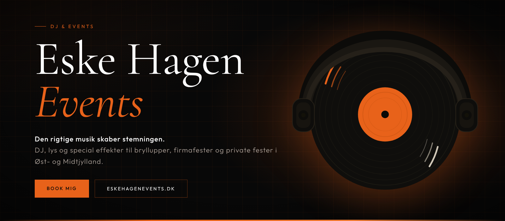
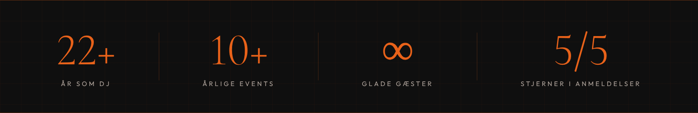
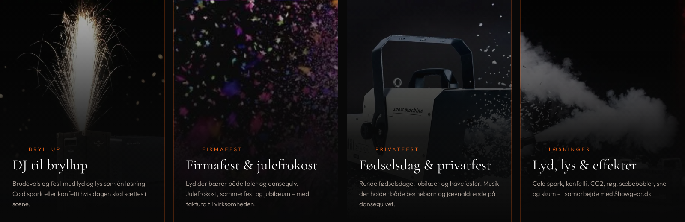
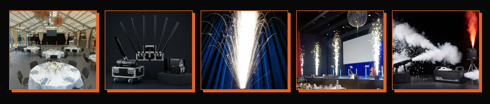
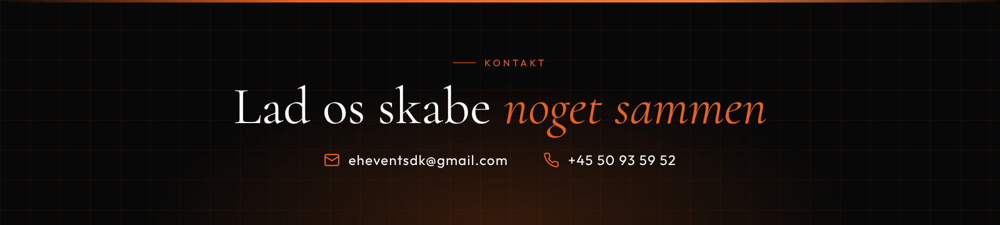

<div align="center">

<a href="https://eskehagenevents.dk">
  
</a>

<br />

[](https://eskehagenevents.dk)
[](https://www.instagram.com/ehevents.dk/)
[](https://vercel.com)

<sub>
<b>Den rigtige musik skaber stemningen</b> &nbsp;·&nbsp; DJ, lys &amp; special effekter &nbsp;·&nbsp; Aarhus
</sub>

</div>

<br />



<br />

## ◆ &nbsp;Om projektet

Dette repo er hjemmesiden for **EH Events** (også kendt som *Eske Hagen Events*), drevet af DJ og eventspecialist **Eske Hagen Sinding** fra Aarhus.

Sitet præsenterer musik, lys og special effekter som **én samlet løsning** til bryllupper, firmafester og private fester i hele Øst- og Midtjylland, og gør det nemt at komme i kontakt og booke.

Designet er mørkt, varmt og filmisk: sort scene, **orange accent** (`#e8621a`), seriffer i overskrifterne og et diskret gitter i baggrunden, som en lysrig i en mørk sal. Der er også et lyst tema, som følger besøgendes systemvalg.

<br />

## ◆ &nbsp;Hvad jeg spiller til



<br />



<br />

## ◆ &nbsp;Sider

| Rute | Indhold |
| :-- | :-- |
| `/` | Forside med hero, om mig, ydelser, anmeldelser, udstyr og samarbejdspartnere |
| `/dj-til-bryllup` | DJ til bryllup |
| `/dj-til-firmafest` | DJ til firmafest og julefrokost |
| `/dj-til-fodselsdag` | DJ til fødselsdag og privatfest |
| `/loesninger` | Lyd, lys og special effekter (cold spark, konfetti, CO2, røg, bobler, sne, skum) |
| `/om-eske` | Baggrund, erfaring og spillesteder |
| `/galleri` | Billeder fra events |
| `/anmeldelser` | Kundernes ord |
| `/faq` | Ofte stillede spørgsmål |
| `/kontakt` | Kontaktformular |
| `/privatlivspolitik` · `/handelsbetingelser` | Juridisk |
| `/visitkort` | Digitalt visitkort som app (PWA) med «Gem i kontakter» |

<br />

## ◆ &nbsp;Under motorhjelmen

<div align="center">

[](https://react.dev)
[](https://www.typescriptlang.org)
[](https://vite.dev)
[](https://tailwindcss.com)
[](https://motion.dev)
[](https://expressjs.com)

</div>

<br />

- **Prerendering til statisk HTML.** Hver rute renderes i Node efter buildet (`scripts/prerender.mjs`), så både søgemaskiner og AI-crawlere får det færdige indhold, ikke en tom `<div id="root">`. Scriptet genererer også `sitemap.xml` og `404.html`.
- **SEO og AI-søgning.** Title, description, canonical, Open Graph og JSON-LD pr. side fra `src/seo/`. Virksomhedens identitet (navn, telefon, område) ligger ét sted i `src/seo/site.ts`. Der følger en `llms.txt` med.
- **Billedoptimering.** WebP ved siden af hver JPG, serveret via `<Picture>` med fallback (`npm run images`).
- **Tema.** Mørkt og lyst tema via CSS-tokens og `data-theme`, med kontrasttjek (WCAG AA) på accentfarven.
- **Kontaktformular.** Produktionssitet sender via et Google Apps Script (`mail_scripts/`). Til lokal udvikling findes en Express-server med Nodemailer (`server.ts`).
- **Måling.** Google tag med konverteringer for telefon- og mailklik, som kun indlæses efter cookie-samtykke. Dertil Vercel Analytics.
- **Digitalt visitkort.** Selvstændig PWA i `public/visitkort/` med vCard og QR-kode.

<br />

## ◆ &nbsp;Kom i gang

**Forudsætninger:** Node.js 20 eller nyere.

```bash
# 1. Installér afhængigheder
npm install

# 2. Start udviklingsserveren (Vite på :3000 + Express på :3001)
npm run dev
```

Åbn <http://localhost:3000>.

### Kontaktformularen lokalt

Opret en `.env` i roden. Den er i `.gitignore` og må aldrig committes.

```bash
OWNER_EMAIL=din@mail.dk          # modtager af henvendelser
GMAIL_USER=din@gmail.com         # afsender
GMAIL_APP_PASSWORD=xxxx-xxxx-xxxx-xxxx   # Gmail app-adgangskode
```

### Scripts

| Kommando | Hvad den gør |
| :-- | :-- |
| `npm run dev` | Vite + Express, med hot reload |
| `npm run build` | Klient-build, SSR-build og prerendering til `dist/` |
| `npm run preview` | Forhåndsvis det byggede site |
| `npm run validate` | Tjekker `dist/` som en crawler ser det (canonical, JSON-LD, kontaktlinks m.m.) |
| `npm run lint` | Typecheck med `tsc --noEmit` |
| `npm run images` | Genererer WebP og web-størrelser af billeder (kræver Python + Pillow) |

<br />

## ◆ &nbsp;Struktur

```text
.
├── src/
│   ├── pages/          # Én fil pr. rute (Home, Bryllup, Faq, Contact …)
│   ├── components/     # Navbar, Footer, Reveal, ReviewsMarquee, GalleryModal …
│   ├── data/           # Anmeldelser, FAQ og effektkatalog – ret teksterne her
│   ├── seo/            # Virksomhedsidentitet, meta og JSON-LD pr. side
│   ├── context/        # Tema (mørk/lys)
│   ├── analytics/      # Google tag
│   └── index.css       # Designtokens og al styling
├── public/
│   ├── images/         # Billeder (JPG + WebP)
│   ├── visitkort/      # Digitalt visitkort (PWA)
│   └── llms.txt        # Resumé til AI-søgning
├── scripts/            # prerender, validate, billedoptimering
├── mail_scripts/       # Google Apps Script til kontaktformularen
├── server.ts           # Lokal mailserver (Express + Nodemailer)
└── vercel.json         # Cache-regler og headers
```

<br />

## ◆ &nbsp;Deploy

Sitet bygges og hostes på **Vercel** med `npm run build` og `dist/` som output. `vercel.json` sætter langtidscache på `/assets` og `/images`, og sørger for at `.vcf`-filerne sendes som `text/vcard`, så «Gem i kontakter» virker på iPhone.

<br />



<div align="center">

<br />

**EH Events** &nbsp;·&nbsp; Eske Hagen Sinding &nbsp;·&nbsp; CVR 46389344 &nbsp;·&nbsp; Aarhus

[eskehagenevents.dk](https://eskehagenevents.dk) &nbsp;·&nbsp; [eheventsdk@gmail.com](mailto:eheventsdk@gmail.com) &nbsp;·&nbsp; [+45 50 93 59 52](tel:+4550935952)

</div>
